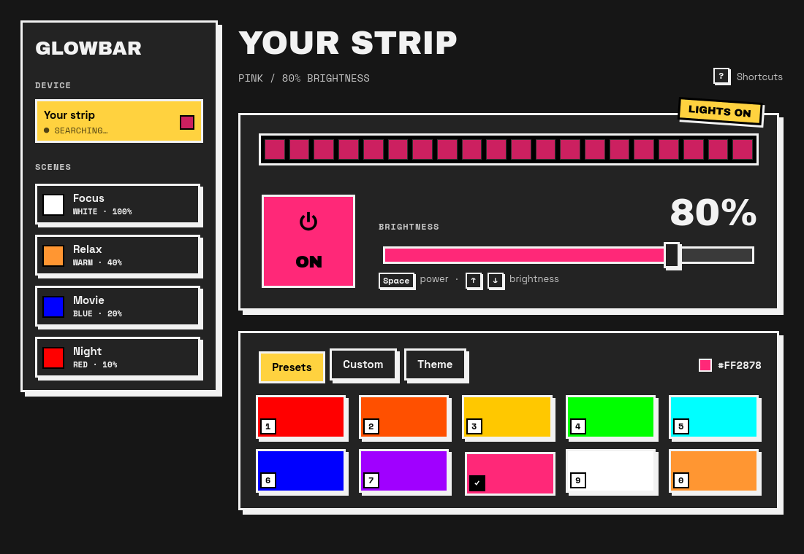

# Glowbar



Control a Bluetooth LED strip from your desktop — switch it on and off, pick a
color, set the brightness, or match your current theme.

Works with **LEDBLE-01** strip controllers (sold under many names, such as the
BJ-AP104 "LED Mood Lights" kit, used with the MohuanLED app) over Bluetooth
LE. The protocol was reverse-engineered by
[8none1/ledble-ledlamp](https://github.com/8none1/ledble-ledlamp).

The controller accepts **one connection at a time**, so close the phone app (or
turn your phone's Bluetooth off) while this window is open. The controller
never reports its own state, so the app remembers the last light it set.

## Features

- Turn the strip on or off with one click or the Space key
- Ten color presets, a custom hue and saturation picker, and a brightness slider
- Scenes that set color and brightness together: Focus, Reading, Relax, Movie
  and Night, plus ten more (Coding, Video call, Candle, Sunset, …) under
  "More scenes"
- Match the strip to your desktop theme (Omarchy/Hyprland)
- Neobrutalist look in light and dark, following your Omarchy theme's mode live
- English, French and Arabic built in
- Reconnects automatically — the controller drops the BLE link every few
  seconds and the app quietly re-opens it and resends the last color

Built with **C++17** and **Qt 6** (Qt Quick for the UI, Qt Bluetooth for the
strip).

## Keyboard shortcuts

| Key | Action |
|-----|--------|
| Space | Turn on or off |
| 1 – 9, 0 | Color presets |
| ← → | Change hue |
| ↑ ↓ | Brightness |
| T | Use desktop theme color |
| R | Search for the strip again |
| ? | Show / hide keyboard shortcuts |
| Q | Quit |

## Requirements

| Platform | Packages needed |
|----------|-----------------|
| **Arch Linux** | `qt6-base` `qt6-declarative` `qt6-connectivity` `qt6-wayland` `bluez` |
| **Ubuntu / Debian** | `qt6-base-dev` `qt6-declarative-dev` `libqt6bluetooth6-dev` `bluez` |
| **Fedora** | `qt6-qtbase-devel` `qt6-qtdeclarative-devel` `qt6-qtconnectivity-devel` `bluez` |
| **macOS** | `brew install qt` (includes everything; Xcode Command Line Tools required) |

## Build

```sh
bin/build      # → build/glowbar  (or build/glowbar.app on macOS)
bin/test       # unit tests, runs offscreen
bin/install    # install system-wide (see notes below)
```

`bin/build` auto-detects `qmake6` / `qmake` and the CPU count on both Linux
and macOS.

### Install notes

| Platform | What `bin/install` does |
|----------|------------------------|
| Arch Linux | Runs `makepkg -fsi` — builds and installs an Arch package |
| Generic Linux | Copies the binary to `$PREFIX/bin` (default `/usr/local`) |
| macOS | Copies `glowbar.app` to `/Applications` (or `$PREFIX`) |

### macOS icon

The `macos/` directory needs a `glowbar.icns` file before building. See
[`macos/README.md`](macos/README.md) for a one-liner that generates it from
the SVG.

## Terminal command

`cli/led` does the same from a terminal. It needs
[uv](https://docs.astral.sh/uv/), which installs its one dependency
([bleak](https://github.com/hbldh/bleak)) automatically on first run.

```sh
cli/led on
cli/led off
cli/led warm              # named colors: red green blue white warm yellow orange pink purple cyan
cli/led 255 120 0         # any RGB value
cli/led '#ff8800'         # hex color
cli/led theme             # Omarchy theme lighting color
```

Finds the first strip named `LEDBLE-*`. To target a specific one, set its
address: `LED_ADDR=C0:00:00:00:12:34 cli/led on`.

`cli/led` works on Linux and macOS without any Qt dependency.

## Protocol

Every command is a 9-byte write to characteristic `0xFFE1` (service `0xFFE0`):

| Command | Bytes |
|---------|-------|
| On  | `7e ff 04 01 ff ff ff ff ef` |
| Off | `7e ff 04 00 ff ff ff ff ef` |
| Color | `7e ff 05 03 RR GG BB ff ef` |

## Platform notes

| Feature | Linux | macOS |
|---------|-------|-------|
| BLE control | ✅ via BlueZ | ✅ via CoreBluetooth |
| Bluetooth on/off detection | ✅ | ⚠️ Not reported by CoreBluetooth — the scan simply times out |
| Light / dark mode | ✅ Omarchy | ⚠️ Always dark |
| Desktop theme color | ✅ Omarchy | ⚠️ Falls back to yellow `#FFD60A` |
| Language file | ✅ Omarchy | ⚠️ Falls back to English |

## Fonts

The UI bundles [Archivo Black](https://github.com/Omnibus-Type/ArchivoBlack),
[Space Grotesk](https://github.com/floriankarsten/space-grotesk) and
[Space Mono](https://github.com/googlefonts/spacemono), all under the SIL Open
Font License (see `src/fonts/`).

## Contributing

Bug reports, translations and support for more strip controllers are all
welcome. See [CONTRIBUTING.md](CONTRIBUTING.md).

## Credits

- Protocol research by [8none1/ledble-ledlamp](https://github.com/8none1/ledble-ledlamp)
- Theme and translation handling adapted from Omacut and Monologue by David
  Heinemeier Hansson (MIT)
- Fonts under the SIL Open Font License (see above)

Full notices are in [NOTICE](NOTICE).

## License

MIT. See [LICENSE](LICENSE).
